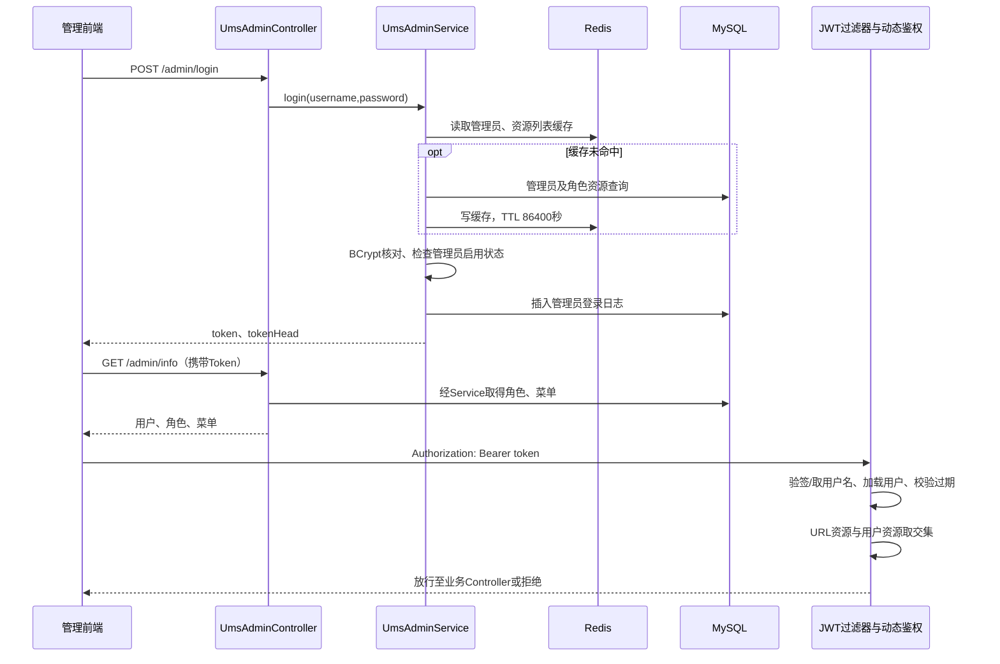
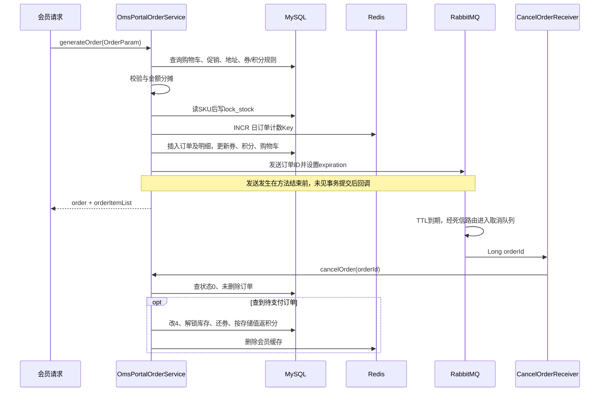
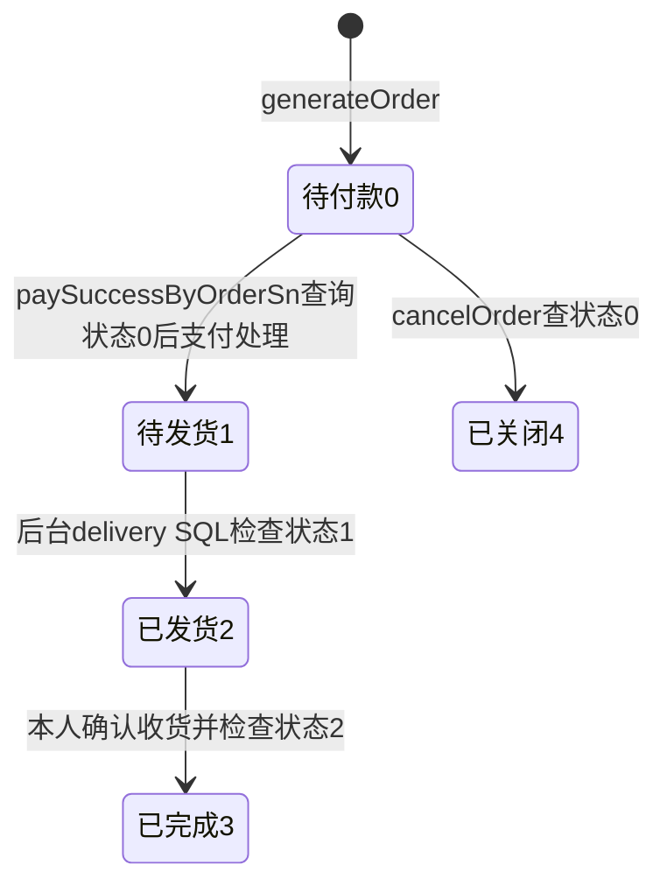
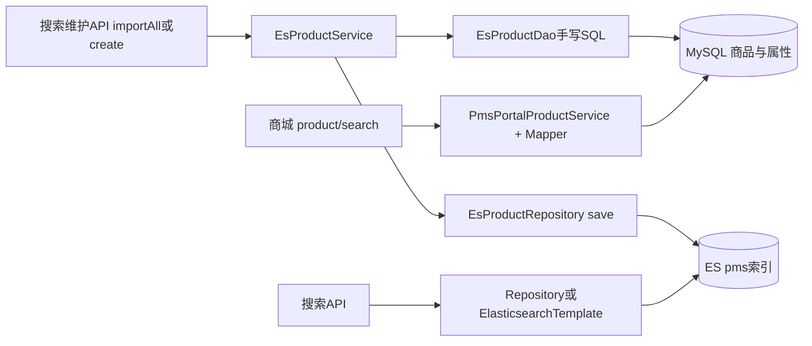
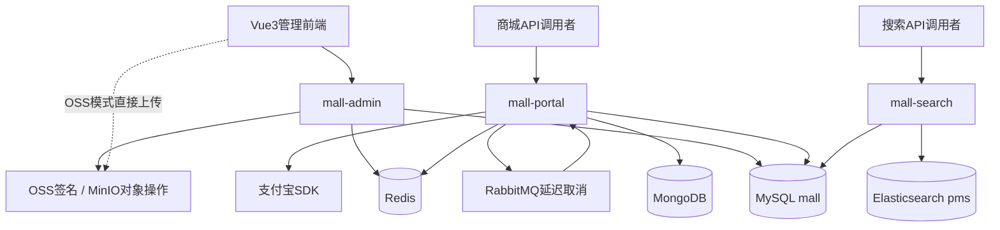
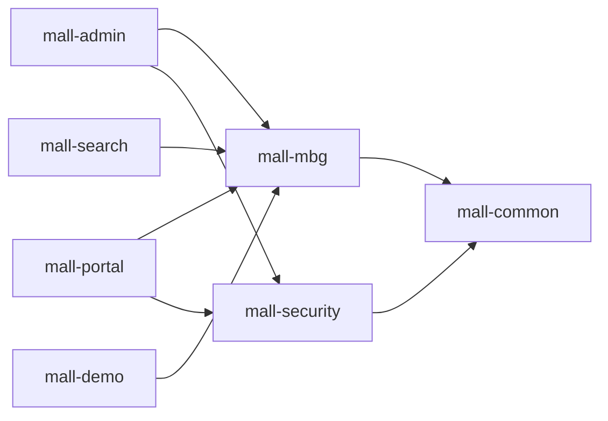
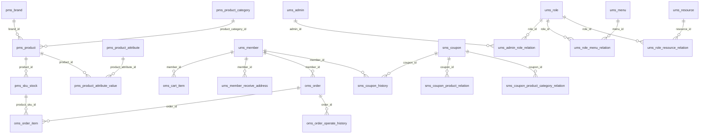

# 项目需求与架构设计说明书

> 现有项目逆向分析版 · 2026-09-17 · 版本 1.0
>
> 分析对象：`D:/project/mall`、`D:/project/mall-admin-web`，以及工作区 `local` 启动材料。本文描述当前工作树可证明的实现，不是新系统方案。

## 阅读说明与证据边界

本说明书由正文和五份附录组成。正文解释运行机制；附录保存逐项核查所需的接口、模型、数据表、Service和需求对应关系。

- [附录A：API完整清单](D:/project/docs/reverse-engineering/附录A-API完整清单.md)
- [附录B：数据库完整字典](D:/project/docs/reverse-engineering/附录B-数据库完整字典.md)
- [附录C：接口模型字段](D:/project/docs/reverse-engineering/附录C-接口模型字段.md)
- [附录D：Service与事务索引](D:/project/docs/reverse-engineering/附录D-Service与事务索引.md)
- [附录E：功能需求与代码追踪](D:/project/docs/reverse-engineering/附录E-功能需求与代码追踪.md)

阅读时会遇到的术语：Controller是HTTP请求入口，Service承载业务处理，Mapper/DAO负责数据库访问，Repository在本项目主要用于MongoDB和ES访问；DTO是接口传递或组合数据的对象。DDL指建表语句，ER图表示数据实体关系。SKU指一种可购买的具体商品规格，SPU在本项目促销代码中对应商品ID层级。JWT是一种带签名的登录凭证，Token是客户端携带的凭证字符串。MQ指消息队列，TTL是消息或缓存有效期，DLX是接收死信转发的交换机；ES是Elasticsearch的简称。幂等指同一业务重复执行不会重复产生效果，不能仅凭方法名判断。

**证据标记**：

- **【已确认事实】**：能够定位到源代码、配置、DDL或前端实现。配置存在只证明仓库配置，不证明线上启用；方法存在只证明实现，不证明所有输入均正确。
- **【代码推断·高可信】**：多处调用共同支持的含义，例如把管理员维护商品理解为商品运营需求。
- **【代码推断·低可信】**：证据有限；不用于宣称功能已完成。
- **【无法确认】**：当前材料或本次静态分析不能证明。
- **【分析意见，不代表当前系统已有设计】**：只在第23章讨论风险与问题。

正文各章的事实段落以该章/小节的证据链接为依据；未单独标记的代码行为描述均属于【已确认事实】。推断与未知单独标记。原有文档、注释与实现冲突时，以实现为准，不把接口摘要直接当成实际效果。

本次完成主源码结构扫描、Controller映射提取、配置与SQL核对、核心业务调用链追踪和文档一致性校验。**没有启动/重启业务服务，没有执行写业务数据的接口，没有重做支付或并发测试。** `local/README.md` 中的历史验收结果仅作为历史记录引用。

快照标识：后端 HEAD `0504e86b1f1b6f1b8aa6a734d37a90fb67346be7`；前端 HEAD `81fc17e5a19f452bd854b106a9d59fa1ed5c7eac`。分析以工作树文件为准，不假定所有文件都等于HEAD。辅助清单 `source-manifest.json` 保存扫描文件的SHA-256；它用于定位文档对应的源码版本，不是运行产物的证明。

## 1. 项目概述

**【代码推断·高可信】** 本项目解决商品资料维护、商城浏览与购买、订单处理、营销内容维护和后台访问授权的问题。其定位可由商品、购物车、会员、订单、营销及权限接口的实际调用与表结构共同确定。

**【已确认事实】** 后端为一个Maven聚合工程，包含7个模块。`mall-admin`、`mall-portal`、`mall-search` 是分别拥有启动类的业务应用；`mall-demo` 是教学演示应用；其余3个是共用代码库。管理前端是另一个Vue工程。业务应用共同使用 `mall-mbg` 的表模型和Mapper，配置均指向名为 `mall` 的MySQL库。

**【代码推断·高可信】** 更准确的表述是“前后端分离、多个Spring Boot应用共享基础代码和关系数据库”。当前材料不足以将其描述为具有独立数据所有权、注册发现和网关治理的完整微服务系统；也没有证据把普通Service/Mapper分层解释为DDD。

**目标使用者**：可匿名访问公开内容的访客、注册/登录后的商城会员、由后台角色及资源授权的管理员。支付通知还存在外部系统调用者，但它不是后台角色。

**【证据】** [MallAdminApplication](D:/project/mall/mall-admin/src/main/java/com/macro/mall/MallAdminApplication.java:1)、[MallPortalApplication](D:/project/mall/mall-portal/src/main/java/com/macro/mall/portal/MallPortalApplication.java:1)、[MallSearchApplication](D:/project/mall/mall-search/src/main/java/com/macro/mall/search/MallSearchApplication.java:1)；[聚合POM](D:/project/mall/pom.xml:12)、[前端依赖](D:/project/mall-admin-web/package.json:1)。

### 1.1 项目侦察结果

扫描范围含519个主源码Java文件；47个有映射方法的Controller，共246个映射方法，其中后台160、商城65、搜索8、教学13。业务接口合计233个。统计不包含框架自动提供的Actuator、SpringDoc等端点，也不把多HTTP动词映射拆成多条。DDL共76张表；接口/业务模型清单收录132个有字段的模型；主源码发现35处 `@Transactional` 声明。

根目录的 `local/runtime`、`.pnpm-store`、虚拟环境、`node_modules`、`target` 不作为自研业务源码。历史Postman集合是参考材料；Controller源码作为接口现状依据。没有发现适用于当前工程的 `AGENTS.md`。原型 `.rp`、思维导图和历史架构图虽存在，但没有据此推定代码中不存在的功能。

## 2. 功能总览

以下功能树的节点均有接口/代码依据；“管理”仅表示下列实际操作，不意味着具备通常同类产品的全部能力。

```text
电商项目
├── 管理前端
│   ├── 登录、菜单导航
│   ├── 商品：列表/新增/编辑/状态、品牌、分类、属性、SKU
│   ├── 订单：查询/详情/发货/关闭/编辑、退货处理、原因与设置
│   ├── 营销：首页广告与推荐、优惠券、秒杀活动/场次/关联商品
│   └── 权限：管理员、角色、菜单、资源与资源分类
├── 后台接口的辅助能力
│   ├── 会员等级查询、公司收货地址查询
│   ├── 专题与优选区域查询（用于商品关联等）
│   └── MinIO上传/删除、OSS上传签名/回调参数整理
├── 商城接口
│   ├── 首页、分类、商品详情、MySQL商品搜索、品牌商品
│   ├── 注册、登录、验证码、改密、会员信息
│   ├── 收货地址、优惠券领取与可用券查询
│   ├── 购物车、结算、订单、确认收货、退货申请
│   ├── 商品收藏、品牌关注、浏览记录（MongoDB）
│   └── 支付宝网页支付发起、查询、通知处理
├── 独立搜索接口：ES导入/创建/删除、搜索、相关商品、聚合筛选
└── 教学示例：品牌CRUD、RestTemplate调用示例
```

### 2.1 功能边界与文档冲突

- **【已确认事实】** 管理端路由主要是 `/pms`、`/oms`、`/sms`、`/ums`；首页图表取本地 `defaultLineChartData`。不能把这个图表称为已接通实时经营报表。
- **【已确认事实】** CMS存在表、模型和部分专题/优选查询。未发现支持README所描述的全套内容后台的对应Controller和管理页面。
- **【已确认事实】** `pms_member_price` 可以维护；但购物车促销计算仅显式处理类型1、3、4，其余走无优惠分支。因此“可配置会员价”不等于“当前结算已按会员价执行”。
- **【已确认事实】** 秒杀活动、场次、商品关系和首页展示存在；本次追踪的下单代码固定 `orderType=0`，未发现独立秒杀购买的库存/限购处理链。
- **【已确认事实】** `payType` 的注释列出微信，但实际第三方支付实现只找到支付宝，不据此宣称微信支付已实现。
- **【无法确认】** 商城移动前端不在当前源码目录，不能还原它当前版本的页面交互。

**【证据】** [管理路由](D:/project/mall-admin-web/src/router/index.ts:1)、[首页图表](D:/project/mall-admin-web/src/views/home/index.vue:35)、[OmsPromotionServiceImpl.calcCartPromotion](D:/project/mall/mall-portal/src/main/java/com/macro/mall/portal/service/impl/OmsPromotionServiceImpl.java:29)、[OmsPortalOrderServiceImpl.generateOrder](D:/project/mall/mall-portal/src/main/java/com/macro/mall/portal/service/impl/OmsPortalOrderServiceImpl.java:94)、[CmsSubjectController](D:/project/mall/mall-admin/src/main/java/com/macro/mall/controller/CmsSubjectController.java:1)、[CmsPrefrenceAreaController](D:/project/mall/mall-admin/src/main/java/com/macro/mall/controller/CmsPrefrenceAreaController.java:1)。

## 3. 用户角色与权限

**【已确认事实】** 管理员实体 `UmsAdmin` 和会员实体 `UmsMember` 分离；各应用JWT密钥配置也分离。后台采用角色关联资源与菜单的方式；商城普通受保护端点采用已认证判定。

SQL初始化数据包含且仅在此作为**样例角色**记录：ID 1“商品管理员”、ID 2“订单管理员”、ID 5“超级管理员”。实际运行库当前角色、成员和授权是否与样例相同，**【无法确认】**。“超级管理员”是表中角色名；动态鉴权实现没有按这一名称硬编码全权限。

后台授权有两条实际关联链：

1. `ums_admin → ums_admin_role_relation → ums_role → ums_role_menu_relation → ums_menu`：返回可展示菜单。
2. `ums_admin → ums_admin_role_relation → ums_role → ums_role_resource_relation → ums_resource`：得到URL资源权限。

`ums_permission`、旧的角色/管理员permission关联表仍存在，但当前JWT资源权限链使用的是 `ums_resource` 体系，不能把旧表当作当前鉴权依据。查询资源/菜单的手写SQL未加入 `ums_role.status=1` 条件，不能仅依据角色存在启停字段就断言禁用角色会立即失权。

前端 `testMode=false`，根据后端菜单 `name` 匹配静态路由并调整标题、图标、隐藏和排序；部分 `hidden=true` 子路由无菜单时仍保留。菜单隐藏不是后端授权。登录后无角色时前端抛出“该用户暂未分配角色”，这是前端的使用限制。

**【证据】** [样例角色](D:/project/mall/document/sql/mall.sql:3110)、[资源关联SQL](D:/project/mall/mall-admin/src/main/resources/dao/UmsAdminRoleRelationDao.xml:1)、[菜单关联SQL](D:/project/mall/mall-admin/src/main/resources/dao/UmsRoleDao.xml:1)、[前端菜单筛选](D:/project/mall-admin-web/src/stores/permission.ts:1)。

## 4. 功能需求逆向

**【代码推断·高可信】** 需求ID是为解释现有实现新增的文档编号，不是恢复了原作者的原始需求编号。附录E按Controller功能簇给出需求ID、使用者、输入、流程、输出、规则、异常、实现类、表及中间件，并列出全部对应接口。以下展开影响交易结果的核心需求。

### REQ-ORDER-001：生成确认单与创建订单

- 使用者：通过商城认证的会员。
- 输入：确认单为JSON购物车ID数组；创建订单为 `OrderParam`，含 `memberReceiveAddressId`、`couponId`、`useIntegration`、`payType`、`cartIds`。
- 处理：取当前会员购物车并计算促销；确认单聚合地址、可用券、会员积分及积分规则。正式下单要求地址ID非空，构造明细、检查可用库存、计算优惠券/积分分摊、增加 `lock_stock`、生成订单号、写订单及明细、标记优惠券使用、扣会员积分、逻辑删除购物车项、发送延迟取消消息。
- 输出：确认单对象；下单返回包含 `order`、`orderItemList` 的Map，外层为 `CommonResult`。
- 规则：当前会员由Security上下文取得；库存可用量为 `stock-lock_stock`；运费与后台折扣初始设0，来源固定1，订单类型固定0，状态固定0。地址查询同时匹配会员ID，但下单只显式检查地址ID非空，查询结果为空后的行为不是友好业务拒绝。
- 金额：总额为单价×数量之和；应付金额为总额+运费−活动优惠−优惠券−积分。优惠券与积分按单价占总价比例分摊，使用代码中的精度与 `HALF_EVEN` 舍入；未发现尾差补齐步骤。
- 积分：检查会员余额、是否可与券并用、最低使用单位与订单抵扣百分比；规则从ID=1的 `ums_integration_consume_setting` 读取。当前写入 `useIntegration` 的时机见第23章，不把预期返还等同于所有订单都能正确返还。
- 异常：地址ID未选、库存不足、券不可用、积分不可用抛 `ApiException`；空对象、非法数量和空购物车并非都有显式校验。
- 持久化：`oms_cart_item`、`oms_order`、`oms_order_item`、`pms_sku_stock`、`sms_coupon_history`、`ums_member`、`ums_member_receive_address`、`oms_order_setting`及促销相关表。
- 中间件：Redis会员缓存与订单号计数；RabbitMQ延迟取消；无直接ES写入。

**【证据】** [OmsPortalOrderController](D:/project/mall/mall-portal/src/main/java/com/macro/mall/portal/controller/OmsPortalOrderController.java:1)、[OmsPortalOrderServiceImpl.generateConfirmOrder](D:/project/mall/mall-portal/src/main/java/com/macro/mall/portal/service/impl/OmsPortalOrderServiceImpl.java:70)、[OmsPortalOrderServiceImpl.generateOrder](D:/project/mall/mall-portal/src/main/java/com/macro/mall/portal/service/impl/OmsPortalOrderServiceImpl.java:94)、[OmsCartItemServiceImpl.listPromotion](D:/project/mall/mall-portal/src/main/java/com/macro/mall/portal/service/impl/OmsCartItemServiceImpl.java:82)、[UmsMemberReceiveAddressServiceImpl.getItem](D:/project/mall/mall-portal/src/main/java/com/macro/mall/portal/service/impl/UmsMemberReceiveAddressServiceImpl.java:71)。

### REQ-ORDER-002：记录支付成功

- 输入：`POST /order/paySuccess` 的 `orderId`、`payType`；或支付宝验签成功通知中的 `out_trade_no`。
- 处理：直接 `paySuccess` 按主键改为待发货并写支付时间/方式，再执行SQL扣真实库存和锁定库存。`paySuccessByOrderSn` 先查询订单号、状态0、未删除，再调用前者。
- 输出：直接接口返回库存更新计数；支付宝Service返回处理结果字符串，HTTP回调输出问题见第23章。
- 规则：直接接口自身没有支付渠道验签、金额核对、旧状态或会员归属判断；订单号路径有待支付查询条件。二者不能合并描述为同一个安全边界。
- 数据：`oms_order`、`oms_order_item`、`pms_sku_stock`；该库存SQL为按SKU ID的CASE更新，没有库存非负约束条件。
- 异常：不存在订单、SDK异常等未全部转化为业务错误；没有证明支付端到端已验证。

**【证据】** [OmsPortalOrderServiceImpl.paySuccess](D:/project/mall/mall-portal/src/main/java/com/macro/mall/portal/service/impl/OmsPortalOrderServiceImpl.java:253)、[OmsPortalOrderServiceImpl.paySuccessByOrderSn](D:/project/mall/mall-portal/src/main/java/com/macro/mall/portal/service/impl/OmsPortalOrderServiceImpl.java:423)、[库存SQL](D:/project/mall/mall-portal/src/main/resources/dao/PortalOrderDao.xml:1)、[AlipayServiceImpl.notify](D:/project/mall/mall-portal/src/main/java/com/macro/mall/portal/service/impl/AlipayServiceImpl.java:72)。

### REQ-ORDER-003：取消未支付订单

- 输入：订单ID；或批量取消接口无方法参数，读取订单设置。
- 入口差异：`/order/cancelUserOrder` 直接调用取消；`/order/cancelOrder` **仅重新发送延迟消息**；`/order/cancelTimeOutOrder` 扫描超时订单；MQ消费者调用单笔取消。
- 处理：单笔取消先查 `id + status=0 + deleteStatus=0`；无记录返回；有记录改4，解除锁定库存、恢复优惠券、按已持久化使用积分返还积分。
- 规则：单笔取消不再次检查创建时间是否已超时；其时间延迟由消息过期承担。单笔取消也未按当前会员ID过滤，不能写成所有取消入口都检查订单归属。
- 输出：HTTP成功外层无数据；消费者记录日志。状态检查使已完成取消后的后续串行消费不再执行恢复操作，但不等于并发幂等已保证。
- 数据：订单、明细、SKU、券历史、会员积分；Redis缓存删除。取消消息本身只携带Long订单ID。

**【证据】** [OmsPortalOrderController.cancelOrder](D:/project/mall/mall-portal/src/main/java/com/macro/mall/portal/controller/OmsPortalOrderController.java:67)、[OmsPortalOrderServiceImpl.cancelOrder](D:/project/mall/mall-portal/src/main/java/com/macro/mall/portal/service/impl/OmsPortalOrderServiceImpl.java:297)、[OmsPortalOrderServiceImpl.cancelTimeOutOrder](D:/project/mall/mall-portal/src/main/java/com/macro/mall/portal/service/impl/OmsPortalOrderServiceImpl.java:268)、[CancelOrderReceiver.handle](D:/project/mall/mall-portal/src/main/java/com/macro/mall/portal/component/CancelOrderReceiver.java:22)。

### REQ-ORDER-004：后台处理订单及会员确认收货

- 管理员按条件查列表/详情，批量发货、关闭、删除，修改地址、运费/折扣、备注。发货SQL含 `status=1`，更新为2并写物流公司/单号/时间；日志对入参列表逐一创建，操作人写固定“后台管理员”。
- 后台关闭仅改状态并写日志，未调用商城取消Service，不包含解锁库存/还券/还积分。费用修改只写运费和折扣及日志，未见重算 `pay_amount`。
- 会员确认收货检查本人订单且状态2，再改3、确认标记和收货时间；会员删除检查本人且状态3或4，再逻辑删除。
- 数据：`oms_order`、`oms_order_item`、`oms_order_operate_history`。后台路径与会员路径的规则不同。

**【证据】** [OmsOrderServiceImpl](D:/project/mall/mall-admin/src/main/java/com/macro/mall/service/impl/OmsOrderServiceImpl.java:1)、[发货状态条件](D:/project/mall/mall-admin/src/main/resources/dao/OmsOrderDao.xml:1)、[OmsPortalOrderServiceImpl.confirmReceiveOrder](D:/project/mall/mall-portal/src/main/java/com/macro/mall/portal/service/impl/OmsPortalOrderServiceImpl.java:337)、[OmsPortalOrderServiceImpl.deleteOrder](D:/project/mall/mall-portal/src/main/java/com/macro/mall/portal/service/impl/OmsPortalOrderServiceImpl.java:408)。

### REQ-AFTERSALE-001：提交与处理退货申请

- 会员认证后的调用者提交 `OmsOrderReturnApplyParam`；Service复制字段并设创建时间、状态0后插入，没有查询原订单并核对归属或可退数量。
- 后台查询退货列表/详情；状态入参1写确认退货、金额、收货地址与处理信息；2写完成退货与收货信息；3写拒绝及处理信息；其他返回0。更新没有根据旧状态限制合法迁移。
- 删除只匹配状态3的申请。数据主要是 `oms_order_return_apply`，详情关联 `oms_company_address`；原因维护使用 `oms_order_return_reason`。
- **未发现支付渠道退款调用、退款流水写入或退货完成后自动库存回补链路。** `returnAmount` 字段不构成实际资金退回证明。

**【证据】** [OmsPortalOrderReturnApplyServiceImpl.create](D:/project/mall/mall-portal/src/main/java/com/macro/mall/portal/service/impl/OmsPortalOrderReturnApplyServiceImpl.java:22)、[OmsOrderReturnApplyServiceImpl.updateStatus](D:/project/mall/mall-admin/src/main/java/com/macro/mall/service/impl/OmsOrderReturnApplyServiceImpl.java:42)。

## 5. 核心业务流程

图中实线表示本次找到的调用，条件步骤按实际代码表示。

### 5.1 管理员登录及受保护请求



图中数据库箭头可经过Service/DAO；不存在统一“登录请求自动由AuthenticationManager完成”的调用，密码比较是项目Service自行执行。

### 5.2 下单与延迟取消



### 5.3 订单状态现状



该图只表示这些**有实际检查条件的路径**。直接 `paySuccess` 按ID强制设1；后台close在未删除条件下设4；不能用图推导出所有入口都强制遵循状态机。状态5“无效订单”在字段说明中存在，但本次主要调用链未找到设为5的业务入口。

### 5.4 搜索数据流



未画管理员改商品自动同步ES的箭头，因为该链路未找到。

## 6. API设计现状

完整的HTTP方法、路径、方法签名、请求Body/参数、返回类型、直接调用及权限在附录A。接口以服务区分，同名路径不代表同一个应用，例如后台 `/product/...` 与商城 `/product/...`。

1. 大多数写操作使用POST，包括 `/update/{id}`、`/delete/...`；不能按REST惯例改记为PUT或DELETE。
2. `@RequestBody` 才表示该参数按请求体绑定；无该注解的复杂参数按当前MVC绑定规则处理，不能笼统写成JSON。文件上传采用 `@RequestPart("file")` 且声明multipart。
3. 多数JSON响应是 `CommonResult<T>`：`code`、`message`、`data`；分页包含 `pageNum/pageSize/totalPage/total/list`。ES `PageRequest`输入页号从0使用，商城MyBatis接口默认多从1使用，Mongo列表显式 `pageNum-1`。
4. `ResultCode.VALIDATE_FAILED=404` 是业务码。Controller返回对象并不自动把HTTP状态设成该业务码；安全拒绝处理类也只写JSON业务码401/403，没有调用 `response.setStatus`。不能把这些值直接记成实际HTTP状态。
5. 支付发起方法直接写HTML；支付宝notify返回String却未标 `@ResponseBody`。该接口不应直接记录为已验证的纯文本回调。
6. API注解的说明不替代方法体：取消接口 `/order/cancelOrder` 实际是发延迟消息，详见第4章。

**【证据】** [CommonResult](D:/project/mall/mall-common/src/main/java/com/macro/mall/common/api/CommonResult.java:1)、[CommonPage](D:/project/mall/mall-common/src/main/java/com/macro/mall/common/api/CommonPage.java:1)、[ResultCode](D:/project/mall/mall-common/src/main/java/com/macro/mall/common/api/ResultCode.java:1)、[RestAuthenticationEntryPoint](D:/project/mall/mall-security/src/main/java/com/macro/mall/security/component/RestAuthenticationEntryPoint.java:1)、[RestfulAccessDeniedHandler](D:/project/mall/mall-security/src/main/java/com/macro/mall/security/component/RestfulAccessDeniedHandler.java:1)、[AlipayController](D:/project/mall/mall-portal/src/main/java/com/macro/mall/portal/controller/AlipayController.java:1)、[EsProductController](D:/project/mall/mall-search/src/main/java/com/macro/mall/search/controller/EsProductController.java:1)。

## 7. 系统架构

### 7.1 实际应用与数据依赖



这是源代码依赖图，**不表示所有外部服务在本机或生产环境都已可用**。Nginx配置只找到静态文件服务，没有 `proxy_pass`，因此不在每个API请求前强行画一个Nginx反向代理。日志收集配置另见第18章。

### 7.2 本地运行材料所描述的拓扑

Windows运行Vite管理网页；启动脚本在WSL Ubuntu-24.04中启动MySQL、Redis和Java应用，All模式另启RabbitMQ、MongoDB及ES。前端API地址由WSL IP写入本地环境文件。此拓扑由脚本确认；当前进程是否正在运行未在本次重验。

**【证据】** [本地入口](D:/project/local/Start-Mall.ps1:1)、[后端启动](D:/project/local/start-backends.sh:1)、[Nginx配置](D:/project/mall/document/docker/nginx.conf:1)。

## 8. 技术选型现状／项目技术清单

以下版本为仓库声明，不自动等于线上安装版本。

| 技术 | 本项目实际用途与使用范围 | 证据 |
| --- | --- | --- |
| Java 17、Spring Boot 3.5.14、Maven | 7模块聚合，打包可启动应用与共用库 | `mall/pom.xml`、各模块POM与Application |
| Spring MVC | Controller映射HTTP，绑定参数/请求体、输出对象 | 附录A全部Controller |
| MyBatis / MyBatis Generator | MBG生成单表Model/Example/Mapper/XML，DAO补充关联与批量SQL | `mall-mbg/pom.xml`、`generatorConfig.xml`、各应用`dao/*.xml` |
| MySQL、Druid、PageHelper | 关系数据、连接池、列表分页 | 各应用`application-dev.yml`、`PageHelper.startPage`调用 |
| Spring Security、BCrypt、Hutool JWT | 后台/会员密码核对、Token解析与资源权限 | `mall-security`及用户Service；不是当前源码直接使用JJWT |
| Redis / Spring Data Redis | 管理员、资源、会员缓存，验证码，日订单编号计数 | CacheService、订单生成方法、BaseRedisConfig |
| RabbitMQ / Spring AMQP | 商城订单TTL到期转发取消消息 | RabbitMqConfig、QueueEnum、Sender/Receiver |
| MongoDB / Spring Data MongoDB | 会员收藏、品牌关注、浏览历史 | portal的三个MongoRepository及Document |
| Elasticsearch / Spring Data Elasticsearch | 独立商品索引、加权检索、相似推荐、聚合筛选 | search的Repository、Template、EsProduct |
| SpringDoc OpenAPI 2.8.17 | 文档分组与`/v3/api-docs`、Swagger UI | POM、各应用application.yml/SpringDocConfig |
| 阿里云OSS SDK、MinIO SDK | OSS签名与回调信息整理；MinIO直接上传/删除 | OssServiceImpl、MinioController |
| 支付宝SDK | 电脑/手机网页支付、查询、通知验签 | portal POM、AlipayServiceImpl/Config |
| SLF4J、Logback、AOP | 控制台/滚动文件、Controller调用日志 | WebLogAspect、logback-spring.xml |
| Logstash / Kibana | 有历史Compose和日志输出配置；实际运行未确认 | document/elk、document/docker、Logback开关 |
| Vue3、TypeScript、Vite、Element Plus | 管理端页面及构建 | 前端package.json、src/views、vite.config.ts |
| Vue Router、Pinia、Axios | 动态菜单、持久化用户状态、HTTP请求/拦截 | router、stores、utils/http.ts |
| ECharts、TinyMCE | 首页本地图表、商品富文本编辑 | views/home、富文本组件与package.json |
| Docker / Compose、Nginx | 保留容器及静态服务部署材料 | document/docker、document/sh、POM插件 |

框架能力不能自动视为业务能力。例如有 `RedisCacheManager` 不代表业务使用Redis锁；有Actuator依赖不代表监控告警已部署；有Dockerfile不代表本机通过Docker启动。

## 9. 项目分层与模块设计

### 9.1 Maven实际依赖



search通过POM排除传入的Redis starter；图只表示内部模块主要依赖，不省略其ES、Mongo、AMQP等外部依赖事实。各业务应用是独立classpath中的启动应用，宽包扫描不等于把另两个业务应用打进当前应用。

### 9.2 实际层次职责

- Controller负责参数绑定、调用Service、包装响应，部分方法还处理Principal或刷新权限元数据。
- Service接口声明操作契约，很多事务声明就在接口上；Impl实现条件判断、计算、多表编排与外部资源调用。
- `dao` 是MyBatis扫描的接口，常用手写XML实现关联查询、批量insert、CASE update。
- `mall-mbg/mapper` 是生成的单表访问接口，`Example` 是动态查询条件对象，不是MyBatis Plus Wrapper。
- `model` 对应表字段；DTO/domain返回对象组合主表和子列表，有些直接继承生成Model；没有强制领域层隔离。
- Repository用于MongoDB与ES；Config定义扫描、连接、序列化、安全和第三方客户端；Component含MQ收发与保留的定时任务类。
- **实际例外**：`MinioController`直接创建MinIO客户端并做上传/删除，没有MinioService层；`UmsResourceController`在业务操作后直接清本进程的动态权限数据源。不能画成所有Controller都只经过统一Service再访问资源。

**【证据】** 各模块POM、[MyBatisConfig](D:/project/mall/mall-admin/src/main/java/com/macro/mall/config/MyBatisConfig.java:1)、[MyBatisConfig](D:/project/mall/mall-portal/src/main/java/com/macro/mall/portal/config/MyBatisConfig.java:1)、[MyBatisConfig](D:/project/mall/mall-search/src/main/java/com/macro/mall/search/config/MyBatisConfig.java:1)、[MinioController](D:/project/mall/mall-admin/src/main/java/com/macro/mall/controller/MinioController.java:1)、[UmsResourceController](D:/project/mall/mall-admin/src/main/java/com/macro/mall/controller/UmsResourceController.java:1)。

## 10. 数据库设计

### 10.1 SQL表的实际范围

76张表按前缀归入商品PMS、订单OMS、营销SMS、会员/后台权限UMS、内容CMS。**业务归类是解释层，字段、主键和索引以附录B逐表原文为准。** 所有表均有生成Model/Mapper不代表所有表都有已实现的产品功能。

核心字段包括：商品 `id/brand_id/product_category_id/publish_status/delete_status/promotion_type`；SKU `id/product_id/sku_code/stock/lock_stock/price/promotion_price`；订单 `id/order_sn/member_id/status/pay_amount/use_integration`；明细 `order_id/product_sku_id/product_quantity/product_price`；券 `use_type/min_point/count/per_limit` 与领取记录 `member_id/coupon_id/use_status`。

DDL使用InnoDB；主键和索引见附录B。本文件中明确的业务唯一索引是会员 `username`、`phone`。本次未在该DDL发现 `FOREIGN KEY` 声明，也未找到订单号、SKU编码或领取关系的业务唯一约束；不要把业务关联画成数据库自动强制的外键。

### 10.2 核心逻辑ER图

下面的连线来自Service查询/写入和DAO联表，表示代码采用的逻辑关联。`||--o{`表示代码使用的一对多关联，不是数据库已约束不存在孤儿记录的承诺。



商品名、品牌名、地址和价格在订单等记录中保存副本。**【代码推断·高可信】** 这些字段使订单能够保留提交时的信息，但并不能据此断言所有订单字段都不可修改，因为后台确有修改接口。

### 10.3 MongoDB持久化

portal配置数据库 `mall-port`。`MemberProductCollection`、`MemberBrandAttention`、`MemberReadHistory` 使用未显式指定collection名的 `@Document`，ID为String；会员ID与商品/品牌ID标有普通 `@Indexed`。**【代码推断·高可信】** 按映射默认规则通常对应类名首字母小写的集合；真实集合名、运行索引是否创建、已有数据数量本次未查询，标为【无法确认】。

`mongo.insert.sqlEnable=true` 时，新增收藏/关注/浏览记录会从MySQL补入商品或品牌信息，再保存Mongo文档。收藏与关注采用先查重复再保存；浏览历史每次生成新记录。按会员列表及清空有归属过滤，浏览历史按任意ID列表删除的入口没有额外会员过滤，详见第23章。

**【证据】** [MemberCollectionServiceImpl](D:/project/mall/mall-portal/src/main/java/com/macro/mall/portal/service/impl/MemberCollectionServiceImpl.java:1)、[MemberAttentionServiceImpl](D:/project/mall/mall-portal/src/main/java/com/macro/mall/portal/service/impl/MemberAttentionServiceImpl.java:1)、[MemberReadHistoryServiceImpl](D:/project/mall/mall-portal/src/main/java/com/macro/mall/portal/service/impl/MemberReadHistoryServiceImpl.java:1)、三个Document与Repository（附录C、D）。

## 11. 数据访问设计

单表查询常见链路是 `Controller → Service → Mapper.selectByExample → 生成XML → MySQL`。例如后台商品列表由 `PmsProductQueryParam`构造 `PmsProductExample` 条件，再调用PageHelper。

复杂查询采用DAO/XML，例如 `PmsProductDao.getUpdateInfo`返回商品及价格、SKU、属性与关联信息，`OmsOrderDao.getDetail`联查订单、明细、操作历史，`EsProductDao.getAllEsProductList`将商品与属性转成ES文档。手写resultMap可继承生成Mapper的映射，复用基础字段。

`insertSelective/updateByPrimaryKeySelective`按非空字段生成列；非Selective操作会包含其生成规则定义的字段。主键来自MySQL自增并回写对象。商品创建通过反射给各明细设 `productId`再调用DAO `insertList`，因此只搜索显式 `dao.insertList(...)`会漏掉这条路径。

MBG配置 `targetRuntime=MyBatis3`、`XMLMAPPER`、表名 `%`、id自增；生成器运行是开发动作，业务请求不会现场生成Java。实际未发现MyBatis Plus Wrapper；没有将其写入技术清单。

**【证据】** [PmsProductServiceImpl.list](D:/project/mall/mall-admin/src/main/java/com/macro/mall/service/impl/PmsProductServiceImpl.java:207)、[PmsProductServiceImpl.relateAndInsertList](D:/project/mall/mall-admin/src/main/java/com/macro/mall/service/impl/PmsProductServiceImpl.java:310)、[生成器配置](D:/project/mall/mall-mbg/src/main/resources/generatorConfig.xml:1)、[编辑聚合SQL](D:/project/mall/mall-admin/src/main/resources/dao/PmsProductDao.xml:1)。

## 12. Redis设计

`redis.database: mall` 是项目拼Key用的命名空间；`spring.data.redis.database: 0` 才是客户端选择的Redis逻辑库。这两个配置不能混为一谈。

| Key实际格式 | Value | TTL | 写入 / 读取 / 删除 |
| --- | --- | --- | --- |
| `mall:ums:admin:{username}` | UmsAdmin对象 | 86400秒 | getAdminByUsername缓存未命中写；登录/过滤器加载读；更新/改密/登出等调用delAdmin |
| `mall:ums:resourceList:{adminId}` | UmsResource列表 | 86400秒 | 非空资源查询结果写；授权加载读；角色分配/资源变更等删相关管理员缓存 |
| `mall:ums:member:{username}` | UmsMember对象 | 86400秒 | getByUsername缓存未命中写；会员认证加载读；改密/积分更新删 |
| `mall:ums:authCode:{telephone}` | 6位数字字符串 | 90秒 | generateAuthCode写；注册/重置密码读；该验证方法未删除，随后按TTL过期 |
| `mall:oms:orderId{yyyyMMdd}` | 自增计数 | 未设置 | generateOrderSn调用INCR；没有日期与orderId之间的额外冒号；未发现该Key清理代码 |

BaseRedisConfig把Key序列化为字符串，普通对象值用Jackson JSON序列化。业务通过RedisService访问；INCR由RedisTemplate的increment执行。订单号为8位日期+2位来源+2位支付方式+至少6位计数；达到7位不会截断，所以不是永远固定18位。

管理员/会员缓存采用先缓存、未命中查库再写回。空资源列表不写缓存。`RedisCacheAspect`包围CacheService方法，捕获Throwable后通常记录错误并返回null；遇到反射取得的方法上的 `@CacheException`则重新抛出。验证码实现方法带该注解；不能进一步宣称所有Redis调用都可以失败降级：订单号INCR直接来自订单Service，不在该切面范围。

**未发现** Redis用作Session、库存扣减、分布式锁、请求幂等Key或统一限流。本项目有业务缓存失效调用，但没有找到数据库与Redis提交的原子协调。

**【证据】** [UmsAdminCacheServiceImpl](D:/project/mall/mall-admin/src/main/java/com/macro/mall/service/impl/UmsAdminCacheServiceImpl.java:1)、[UmsMemberCacheServiceImpl](D:/project/mall/mall-portal/src/main/java/com/macro/mall/portal/service/impl/UmsMemberCacheServiceImpl.java:1)、[RedisCacheAspect](D:/project/mall/mall-security/src/main/java/com/macro/mall/security/aspect/RedisCacheAspect.java:1)、[BaseRedisConfig](D:/project/mall/mall-common/src/main/java/com/macro/mall/common/config/BaseRedisConfig.java:1)、[RedisServiceImpl](D:/project/mall/mall-common/src/main/java/com/macro/mall/common/service/impl/RedisServiceImpl.java:1)、[OmsPortalOrderServiceImpl.generateOrderSn](D:/project/mall/mall-portal/src/main/java/com/macro/mall/portal/service/impl/OmsPortalOrderServiceImpl.java:439)。

## 13. MQ设计

| 项目 | 实际实现与确认程度 |
| --- | --- |
| Producer | 【已实现】CancelOrderSender，AmqpTemplate.convertAndSend |
| 发送时机 | 【已实现】下单最后阶段；另有HTTP接口主动重新发送 |
| 内容 | 【已实现】Long订单ID，未附带订单明细、版本或幂等键 |
| 延迟交换机 / Routing Key / Queue | 【已实现】`mall.order.direct.ttl` / `mall.order.cancel.ttl` / `mall.order.cancel.ttl` |
| 到期转发 | 【已实现】消息expiration，队列x-dead-letter-exchange/routing-key |
| 消费交换机 / Routing Key / Queue | 【已实现】`mall.order.direct` / `mall.order.cancel` / `mall.order.cancel` |
| Consumer | 【已实现】CancelOrderReceiver，@RabbitListener + @RabbitHandler，调用cancelOrder |
| 延迟长度 | 【已实现】oms_order_setting主键1的normal_order_overtime × 60 × 1000毫秒 |
| 手工ACK/NACK | 【未发现】消费者未注入Channel并调用basicAck/basicNack；也未找到显式acknowledge-mode覆盖 |
| ACK实际模式 | 【代码推断·高可信】依赖Spring AMQP容器默认处理；运行时有效配置/确认时点未取证，不宣称已验证 |
| 生产确认、Return回调 | 【未发现】项目级发送确认回调、mandatory返回补偿链 |
| 消费重试策略 | 【未发现】项目级重试/失败落库/补偿任务；Broker与容器运行配置【无法确认】 |
| 死信 | 【已实现】TTL到期转发用于延迟；消费失败后的独立业务死信补偿【未发现】 |
| 幂等 | 【已实现】取消前查状态0；独立消息去重记录/原子状态竞争【未发现】 |

队列/交换机由RabbitMqConfig和QueueEnum决定。`application.yml`另有 `rabbitmq.queue.name.cancelOrder: cancelOrderQueue`，但本次收发路径不用该名称，消费者明确监听 `mall.order.cancel`。队列持久化声明不能单独证明消息从数据库提交到最终消费的端到端可靠性。

定时器 `OrderTimeOutCancelTask` 有每10分钟的 `@Scheduled`，但 `@Component`已注释，未发现别处注册该类。**当前不能记为启用的定时扫描兜底。** 批量取消Service和HTTP端点仍存在。

**【证据】** [RabbitMqConfig](D:/project/mall/mall-portal/src/main/java/com/macro/mall/portal/config/RabbitMqConfig.java:1)、[QueueEnum](D:/project/mall/mall-portal/src/main/java/com/macro/mall/portal/domain/QueueEnum.java:1)、[CancelOrderSender](D:/project/mall/mall-portal/src/main/java/com/macro/mall/portal/component/CancelOrderSender.java:1)、[CancelOrderReceiver](D:/project/mall/mall-portal/src/main/java/com/macro/mall/portal/component/CancelOrderReceiver.java:1)、[OrderTimeOutCancelTask](D:/project/mall/mall-portal/src/main/java/com/macro/mall/portal/component/OrderTimeOutCancelTask.java:1)。

## 14. Elasticsearch设计

索引实体 `EsProduct` 声明 `indexName="pms"`，1分片、0副本；这是代码声明，运行索引是否按此创建未查询。商品ID为文档ID，SKU库存没有独立建立索引实体。

- `productSn`、`brandName`、`productCategoryName` 显式Keyword，用于精确值/聚合。
- `name`、`subTitle`、`keywords` 显式Text，分析器 `ik_max_word`，因此需要匹配的IK插件。
- `attrValueList` 显式Nested且fielddata=true；内部value/name为Keyword，其余未显式Field类型的字段不能在文档中捏造实际Mapping。
- 简单搜索用Repository派生方法；综合搜索使用ElasticsearchTemplate与NativeQuery。
- 综合搜索可按品牌/分类term过滤，按name/subTitle/keywords权重10/5/2累计评分，minScore=2；可按新品ID、销量或价格排序，同时添加_score排序。
- 相关商品根据MySQL读取的目标商品信息构造检索，排除自身ID；name/subTitle/keywords/brandId/categoryId权重8/2/2/5/3。
- 相关信息聚合品牌、分类与属性；Nested属性过滤type=1，再按属性ID、值、名称聚合，多处size固定10。

**数据同步实际是显式接口调用**：importAll读取当前未删除且上架商品并saveAll；create(id)读取后save；delete按ID删除ES文档。importAll不先清空索引，因此不能写成“每次全量重建保证移除下架旧数据”。未发现后台商品更新后自动通知ES、CDC订阅或MQ索引消费者。

**【证据】** [EsProduct](D:/project/mall/mall-search/src/main/java/com/macro/mall/search/domain/EsProduct.java:1)、[EsProductAttributeValue](D:/project/mall/mall-search/src/main/java/com/macro/mall/search/domain/EsProductAttributeValue.java:1)、[EsProductServiceImpl](D:/project/mall/mall-search/src/main/java/com/macro/mall/search/service/impl/EsProductServiceImpl.java:1)、[索引读取SQL](D:/project/mall/mall-search/src/main/resources/dao/EsProductDao.xml:1)。

## 15. 登录、认证与权限

### 15.1 登录与Token

后台Service主动查用户/资源、BCrypt比较输入密码、检查管理员 `isEnabled`、创建Authentication放入SecurityContext、生成Token并写登录日志。会员Service也主动比较密码并生成Token，但未像后台一样在login中显式检查 `isEnabled`。

Token由Hutool `JWTUtil.createToken` 创建，payload写用户名sub、created以及 `当前毫秒时间+expiration*1000` 的exp。`isTokenExpired`用毫秒比较；不把类注释里的HS512当成当前代码已显式指定的算法，因为创建调用没有设置算法参数。配置有效期604800秒。

过滤器从Authorization提取Bearer后验证签名并取用户名，重新通过UserDetailsService加载用户，核对用户名及过期，再设置Authentication。它没有调用完整的登录密码流程，也没有显式检查UserDetails启用状态。JWT缺少exp时当前代码返回“不超期”，这里只描述实现，不表示赞同该判定。

refreshHeadToken对未过期Token尝试刷新，30分钟内则返回原Token；其created字段类型分支以及与外部JWT实现的兼容性未经运行验证。后台logout删除缓存，前端清token；**未发现服务端Token黑名单/撤销版本号**，不能将登出描述为对已签发Token即时撤销。

### 15.2 资源判定

SecurityConfig依次放行配置白名单与OPTIONS；其余请求，有动态权限Bean时交给DynamicAuthorizationManager，否则使用已认证判断。关闭CSRF，Session策略为STATELESS（不依赖服务器会话保存登录状态）。

后台配置DynamicSecurityService，加载 `url → resourceId:name` 的进程内Map；用户GrantedAuthority也由资源ID/名称构造。URL用AntPathMatcher匹配，所需资源与持有资源有交集才放行。**未命中任何资源时needAuthorities为空，当前实现返回拒绝，不是“登录即可访问”。** 不按HTTP Method区分资源规则。

后台资源新增/修改/删除后Controller清当前进程Map，下次请求重载；Service另清相关Redis资源缓存。未发现跨进程通知其他实例清Map的链路。商城未定义这一动态资源Bean，所以非白名单主要要求已认证，具体数据归属由各Service自己检查。

`/admin/info`、`/admin/logout`虽在白名单，但方法仍使用Principal；配置放行不等于匿名请求就能成功执行业务。商城 `/sso/**`白名单同样不能推导每个方法可匿名获取会员信息。详情见附录A与第23章。

**【证据】** [SecurityConfig](D:/project/mall/mall-security/src/main/java/com/macro/mall/security/config/SecurityConfig.java:1)、[JwtTokenUtil](D:/project/mall/mall-security/src/main/java/com/macro/mall/security/util/JwtTokenUtil.java:1)、[JwtAuthenticationTokenFilter](D:/project/mall/mall-security/src/main/java/com/macro/mall/security/component/JwtAuthenticationTokenFilter.java:1)、[DynamicAuthorizationManager](D:/project/mall/mall-security/src/main/java/com/macro/mall/security/component/DynamicAuthorizationManager.java:1)、[DynamicSecurityMetadataSource](D:/project/mall/mall-security/src/main/java/com/macro/mall/security/component/DynamicSecurityMetadataSource.java:1)、[AdminUserDetails](D:/project/mall/mall-admin/src/main/java/com/macro/mall/bo/AdminUserDetails.java:1)、[MemberDetails](D:/project/mall/mall-portal/src/main/java/com/macro/mall/portal/domain/MemberDetails.java:1)、[UmsAdminServiceImpl.login](D:/project/mall/mall-admin/src/main/java/com/macro/mall/service/impl/UmsAdminServiceImpl.java:99)、[UmsMemberServiceImpl.login](D:/project/mall/mall-portal/src/main/java/com/macro/mall/portal/service/impl/UmsMemberServiceImpl.java:165)。

## 16. 事务与数据一致性

35处主源码事务声明全部在本次附录D逐项列出。这里的事务是Spring管理的本地数据库事务，不是跨Redis/MQ/ES的原子事务。

主要覆盖：商品创建/编辑/审核、品牌更新、分类与属性变更、优惠券及关系维护、首页推荐批量创建、秒杀商品关系批量创建、管理员角色分配、角色菜单/资源分配、订单发货/关闭/编辑、会员注册/改密、地址更新、购物车添加/改规格、领券、下单/支付/取消。

`PmsProductService.create`显式写DEFAULT隔离级别与REQUIRED传播；其他多数只有 `@Transactional`。没有在这些声明中发现统一指定 `rollbackFor=Exception.class`。实际数据库默认隔离级别不能只凭DEFAULT注解断言。`ApiException`继承RuntimeException；未被捕获的运行时异常可沿事务代理触发回滚，不能据此说任意异常或HTTP失败都回滚。

**事务边界实例**：下单经Service代理进入后，多个MySQL写操作处于同一本地事务；Redis INCR/缓存删除和AMQP发送不随SQL回滚恢复。发送MQ就在方法返回前，没有找到afterCommit、事务消息表或分布式事务协调。ES导入和Mongo保存也不受订单MySQL事务覆盖。

`paySuccessByOrderSn`内部自调用paySuccess，但外层本身有事务声明，所以这条外部调用仍有外层事务；不能误报“自调用导致整个支付路径完全没有事务”。判断应看进入代理的最外层方法。

**【证据】** [全部事务声明](D:/project/docs/reverse-engineering/附录D-Service与事务索引.md)、[OmsPortalOrderService](D:/project/mall/mall-portal/src/main/java/com/macro/mall/portal/service/OmsPortalOrderService.java:1)、[PmsProductService](D:/project/mall/mall-admin/src/main/java/com/macro/mall/service/PmsProductService.java:1)、[ApiException](D:/project/mall/mall-common/src/main/java/com/macro/mall/common/exception/ApiException.java:1)。

## 17. 并发与幂等

**【已确认事实】** 搜索主源码、DAO/XML和DDL后，当前未发现显式 `SELECT ... FOR UPDATE`、`@Version`乐观锁、Redisson、Redis setIfAbsent锁、请求幂等Key或消息去重表的实现。字段名/依赖版本中的version不作为乐观锁证据。

已经存在的局部机制必须如实保留：

- Redis INCR用于订单编号计数，单次计数是原子操作；它不覆盖创建订单的其他步骤。
- 后台delivery的UPDATE有旧状态1条件；这比先查后无条件改更明确，但操作历史仍按全部请求项插入。
- cancelOrder和paySuccessByOrderSn查询旧状态；可以阻止已经完成更新后再次进入的串行重复处理。
- 会员用户名/电话有唯一索引，数据库可拒绝重复值；并不代表所有业务编号都唯一受约束。
- Mongo收藏/关注是先查询后插入，未发现会员+目标ID的唯一联合索引声明。

**【代码推断·高可信】** 库存lockStock采用读取旧值、Java加数量、再按主键覆盖写入；单笔取消及订单号支付也存在“先查后更新”的间隙，缺少原子旧状态条件，不能认定在并发情况下具有严格防超卖或幂等保证。实际并发影响属于第23章分析意见，未进行负载复现。

**【证据】** [OmsPortalOrderServiceImpl.lockStock](D:/project/mall/mall-portal/src/main/java/com/macro/mall/portal/service/impl/OmsPortalOrderServiceImpl.java:727)、[OmsPortalOrderServiceImpl.cancelOrder](D:/project/mall/mall-portal/src/main/java/com/macro/mall/portal/service/impl/OmsPortalOrderServiceImpl.java:297)、[UmsMemberCouponServiceImpl.add](D:/project/mall/mall-portal/src/main/java/com/macro/mall/portal/service/impl/UmsMemberCouponServiceImpl.java:43)、[后台发货SQL](D:/project/mall/mall-admin/src/main/resources/dao/OmsOrderDao.xml:1)、[会员唯一索引](D:/project/mall/document/sql/mall.sql:2733)。

## 18. 异常与日志

`Asserts.fail`抛ApiException；GlobalExceptionHandler处理ApiException、MethodArgumentNotValidException、BindException和SQLSyntaxErrorException。参数异常只选一个FieldError构造消息；SQL错误含denied时替换为演示环境提示。未发现统一捕获所有Throwable的ControllerAdvice，所以不能宣称所有异常都会产生完全一致的业务响应。

部分Controller通过受影响行数判断成功/失败，部分总是success，即使内部结果为空；支付宝SDK部分异常捕获后打印并继续，MinIO上传/删除捕获异常后返回failed。这些分支不能用一个笼统“全局统一处理”覆盖。

WebLogAspect包围Controller公共方法，读取请求信息、参数、返回结果、耗时，调用日志输出。日志在 `joinPoint.proceed()`正常返回后构建，不是finally，因此抛出异常时该段完整WebLog不会执行。抽取参数只看RequestBody和RequestParam等实际分支，没有找到统一敏感字段脱敏。

Logback配置控制台、DEBUG/ERROR滚动文件，另有Logstash TCP输出条件分支；application-dev配置 `enableInnerLog=false`。保留的Compose包含Logstash/ES/Kibana，但它们是否实际运行**【无法确认】**。管理员登录日志、订单操作历史、商品审核记录是业务表记录，不等于WebLog。

**【证据】** [GlobalExceptionHandler](D:/project/mall/mall-common/src/main/java/com/macro/mall/common/exception/GlobalExceptionHandler.java:1)、[WebLogAspect](D:/project/mall/mall-common/src/main/java/com/macro/mall/common/log/WebLogAspect.java:1)、[Logback](D:/project/mall/mall-common/src/main/resources/logback-spring.xml:1)、[OmsOrderServiceImpl](D:/project/mall/mall-admin/src/main/java/com/macro/mall/service/impl/OmsOrderServiceImpl.java:1)、[PmsProductServiceImpl.updateVerifyStatus](D:/project/mall/mall-admin/src/main/java/com/macro/mall/service/impl/PmsProductServiceImpl.java:234)。

## 19. 配置与部署

### 19.1 随仓配置

admin/portal/search主配置默认激活dev；开发/生产配置分别列出数据源、Redis/Mongo/Rabbit/ES、日志和外部服务参数。MyBatis加载 `classpath:dao/*.xml`与生成Mapper XML。Portal开发端口8085、search端口8081；admin本地启动与Compose使用8080。不能将未连接验证的默认地址记为生产资产。

前端Axios基址来自 `VITE_BASE_SERVER_URL`，5秒超时；`VITE_USE_OSS`选择上传方式，另有OSS与MinIO地址变量。package.json要求Node `^20.19.0 || >=22.12.0`；构建脚本并行执行类型检查与Vite构建。

### 19.2 本地启动路径

`Start-Mall.ps1`的Infra模式启动MySQL/Redis；Admin模式启动后台和管理前端；All模式增加商城、搜索及其依赖。`-Build`构建使用 `-DskipTests -Ddocker.skip=true`；调试端口5005为可选。脚本会写前端 `.env.development.local`，并等待后端健康检查。本文只说明脚本行为，本次没有调用启动脚本。

`run-backend.sh`执行Java JAR并覆盖本地连接配置；其中凭据不复制到说明书。脚本、README和实际线上部署是三种证据层次，不相互替代。

### 19.3 容器材料与现状差异

仓库有基于openjdk:17的Dockerfile、Fabric8 Maven插件、应用与环境Compose。环境模板含MySQL5.7、ES7.17.3等历史版本；当前本地说明记录MySQL8与ES8.18.0，搜索代码使用新的Elasticsearch客户端类型。因此只能说“保留这些部署材料”，不保证旧模板与当前依赖组合已兼容验收。

Nginx模板静态托管html，不含proxy_pass；未发现可据以确认生产负载均衡、TLS终止、备份、弹性扩缩容、灾备、日志保留策略落地状态的材料。

### 19.4 测试证据

主POM默认 `skipTests=true`。仓库有SpringBootTest、商品DAO测试及搜索测试，部分以打印为主；admin的测试目录是 `src/test/com/...`，与常见Maven Java测试路径不同，未发现专门的路径配置，不能认定标准构建会执行这些测试。`mall/tests/api`当前只找到requirements依赖文件，虚拟环境的第三方测试不算本项目测试。

`local/README.md`记录2026-09-14的打包及部分接口验证，并明确未完成完整延迟取消、支付、上传和并发实验。本次不把这些历史文字升级为当前完整验收。没有可证明覆盖率或服务等级目标的现行材料。

**【证据】** [本地说明](D:/project/local/README.md:1)、[启动脚本](D:/project/local/Start-Mall.ps1:1)、[前端请求](D:/project/mall-admin-web/src/utils/http.ts:1)、[构建配置](D:/project/mall/pom.xml:35)、[容器模板](D:/project/mall/document/docker/docker-compose-env.yml:1)。

## 20. 核心技术机制索引

| 机制 | 作用、触发与调用 | 最终影响 |
| --- | --- | --- |
| JWT认证 | login → 用户Service → JwtTokenUtil；请求 → JwtAuthenticationTokenFilter | SecurityContext中的当前用户；登录Token |
| 动态资源授权 | SecurityConfig → DynamicAuthorizationManager → 元数据Map/用户资源 | 当前请求能否进入Controller，不直接改变业务表 |
| 缓存读取与失效 | 用户加载 → CacheService → RedisService；用户/角色资源变更 → 删除Key | 用户与资源缓存，TTL见第12章 |
| 订单编号 | generateOrder → generateOrderSn → Redis INCR | Redis日计数与MySQL order_sn |
| 延迟取消 | 下单 → Sender → TTL/DLX → Receiver → cancelOrder | 订单状态、锁定库存、券记录、会员积分 |
| ES检索 | ES维护接口显式同步；搜索接口调用Repository/Template | pms索引文档和检索响应 |
| MBG单表访问 | Generator读取数据库结构生成Model/Example/Mapper；运行期调用生成代码 | SQL访问映射，无运行期自动生成流程 |
| 数据库事务 | 注解Service代理编排多表写入 | 本地SQL提交/回滚，不覆盖Redis/MQ/ES |
| Mongo行为记录 | 收藏/关注/浏览入口 → Service → MongoRepository；开关控制SQL补数据 | 会员行为文档，不是订单关系表 |

各机制的实现与限制分别见第11—18章；没有把“提供某组件”扩大为“拥有该组件的全部能力”。另一个实际数据访问细节是后台SKU更新：先按传入productId筛选SKU列表，再执行 `REPLACE INTO pms_sku_stock`，不是普通UPDATE；语句列清单不包含lock_stock、promotion_price。这是读取库存相关行为时需要保留的现状。

**【证据】** [SKU更新Service](D:/project/mall/mall-admin/src/main/java/com/macro/mall/service/impl/PmsSkuStockServiceImpl.java:35)、[SKU手写SQL](D:/project/mall/mall-admin/src/main/resources/dao/PmsSkuStockDao.xml:1)。

## 21. 需求—代码对应关系

完整追踪表和每个需求的接口集合在附录E。正文给出核心跨模块例子：

| 需求ID | Controller / Service | Mapper / DAO与表 | Redis / MQ / ES |
| --- | --- | --- | --- |
| REQ-ORDER-001 | OmsPortalOrderController / OmsPortalOrderServiceImpl | 订单、明细、购物车、SKU、券历史、会员；PortalOrderItemDao及相关Mapper | 会员缓存/订单计数；发送取消消息；无直接ES |
| REQ-ORDER-002 | 同上 / paySuccess、paySuccessByOrderSn | OmsOrderMapper、PortalOrderDao；订单/明细/SKU | 无直接新增Redis/MQ/ES操作 |
| REQ-ORDER-003 | 同上及CancelOrderReceiver / cancelOrder | 订单/明细/SKU/券历史/会员 | 删会员缓存；消费取消消息 |
| REQ-ORDER-004 | 后台OmsOrderController及商城订单Controller | OmsOrderDao、OperateHistoryDao；订单/日志 | 后台这些操作未见直接中间件调用 |
| REQ-AFTERSALE-001 | 前台退货与后台退货Controller | OmsOrderReturnApplyMapper/Dao；申请/公司地址 | 未见资金退款或中间件链路 |

附录E的表集合表示该需求功能簇可触达的数据，不表示每个接口每次都操作所有表；每个接口的直接调用以附录A为准。隐式认证链读取的Redis不重复算作每个业务接口的直接缓存操作。

## 22. 当前无法确认的设计

- **UNKNOWN-001 生产拓扑与配置**：【无法确认】当前线上版本、实例数、数据库/中间件版本、域名、外部安全控制；原因是只有仓库配置与本地材料。
- **UNKNOWN-002 运行数据与Schema偏差**：【无法确认】当前运行库与76表DDL逐字段是否一致，线上角色/索引是否相同；本次未查询数据库。
- **UNKNOWN-003 支付端到端状态**：【无法确认】真实/沙箱凭据是否在别处配置、回调是否公网可达、交易与回调是否验收；仓库有占位项。
- **UNKNOWN-004 MQ运行策略**：【无法确认】部署时的ACK/requeue/retry、Broker策略、消息持久化落盘与失败补偿效果；源码没有完整业务确认链。
- **UNKNOWN-005 高并发结果**：【无法确认】库存超卖、并发重复取消/支付的实际出现概率和负载边界；没有本次并发复现实验。
- **UNKNOWN-006 ES运行Mapping与同步运维**：【无法确认】真实索引Mapping、历史脏文档、是否有人在系统外定时调用同步API。
- **UNKNOWN-007 Mongo集合与索引**：【无法确认】运行集合、索引创建结果、重复文档现状；只见Document与Repository声明。
- **UNKNOWN-008 原始产品决策**：【无法确认】业务立项背景、优先级、性能指标、验收标准、运营约束；逆向需求不能冒充原始批准需求。
- **UNKNOWN-009 移动前端**：【无法确认】页面、按钮和API组合的当前实现；源码缺席。
- **UNKNOWN-010 上传与日志基础设施**：【无法确认】MinIO/OSS当前可用性、Logstash/Kibana部署与接收结果；有代码/配置不等于可用。
- **UNKNOWN-011 框架默认行为的运行确认**：【无法确认】事务代理实际模式、序列化运行结果、所有异常最终HTTP格式；本次以声明和显式调用为证，没有声称全路径运行验收。

## 23. 现有设计观察与潜在问题

> 本章统一标记：**【分析意见，不代表当前系统已有设计】**。以下是从静态实现得出的风险判断，不是已经在本次运行中复现的事故，不是新架构要求。没有修改业务代码。

### OBS-001：部分订单入口缺少对象归属或支付真实性约束

商城order/detail按ID读取订单与明细，未比较当前会员；cancelUserOrder进入的cancelOrder只检查状态/删除标记；直接paySuccess按ID写付款完成，未验支付来源、旧状态、金额或归属。相比之下confirmReceiveOrder/deleteOrder显式检查会员，说明不能把统一JWT认证当作全套对象权限。认证会员可能对非本人对象产生读取/修改风险，是否受部署外围限制无法确认。

**【证据】** [OmsPortalOrderServiceImpl.detail](D:/project/mall/mall-portal/src/main/java/com/macro/mall/portal/service/impl/OmsPortalOrderServiceImpl.java:396)、[OmsPortalOrderServiceImpl.cancelOrder](D:/project/mall/mall-portal/src/main/java/com/macro/mall/portal/service/impl/OmsPortalOrderServiceImpl.java:297)、[OmsPortalOrderServiceImpl.paySuccess](D:/project/mall/mall-portal/src/main/java/com/macro/mall/portal/service/impl/OmsPortalOrderServiceImpl.java:253)。

### OBS-002：下单使用积分字段赋值在插入之后

`orderMapper.insert(order)`在 `order.setUseIntegration(...)`之前；之后未见再次更新该订单字段。会员积分会被扣减，而取消读取持久化订单 `useIntegration`决定返还，可能导致无法按预期返还。响应中的内存order对象可以有该值，不能据此证明数据库已写入。

**【证据】** [OmsPortalOrderServiceImpl.generateOrder](D:/project/mall/mall-portal/src/main/java/com/macro/mall/portal/service/impl/OmsPortalOrderServiceImpl.java:94)、[OmsPortalOrderServiceImpl.cancelOrder](D:/project/mall/mall-portal/src/main/java/com/macro/mall/portal/service/impl/OmsPortalOrderServiceImpl.java:297)。

### OBS-003：锁库存与串行状态检查不足以证明并发安全

lockStock读旧值再覆盖；取消/支付查询旧状态后按主键更新，没有原子竞争条件。并发请求可能重复执行业务效果或丢失锁定量更新。后台发货虽然有SQL状态条件，但操作日志按入参列表写，可能产生未实际发货订单的日志。未进行压力验证。

**【证据】** [OmsPortalOrderServiceImpl.lockStock](D:/project/mall/mall-portal/src/main/java/com/macro/mall/portal/service/impl/OmsPortalOrderServiceImpl.java:727)、[库存更新SQL](D:/project/mall/mall-portal/src/main/resources/dao/PortalOrderDao.xml:1)、[OmsOrderServiceImpl.delivery](D:/project/mall/mall-admin/src/main/java/com/macro/mall/service/impl/OmsOrderServiceImpl.java:42)。

### OBS-004：数据库提交与外部资源操作存在间隙

下单事务内就发送MQ，未见事务提交后发送或事务消息记录；缓存删除也不跟随SQL回滚。发送成功后数据库提交失败、缓存删除与其他线程回填交错等情况下，存在状态不一致可能。代码未提供可证明这些异常均被补偿的机制。

**【证据】** [OmsPortalOrderServiceImpl.generateOrder](D:/project/mall/mall-portal/src/main/java/com/macro/mall/portal/service/impl/OmsPortalOrderServiceImpl.java:94)、[CancelOrderSender](D:/project/mall/mall-portal/src/main/java/com/macro/mall/portal/component/CancelOrderSender.java:1)、[UmsMemberServiceImpl.updateIntegration](D:/project/mall/mall-portal/src/main/java/com/macro/mall/portal/service/impl/UmsMemberServiceImpl.java:147)。

### OBS-005：后台关闭与会员取消效果不同

后台close仅改状态与写操作历史，不恢复库存/优惠券/积分；如果关闭了已锁库存的待支付订单，后续MQ查询status=0不会再进入取消恢复分支。修改费用也只写freightAmount/discountAmount，没有重算payAmount。两条路径的业务结果需要区别阅读。

**【证据】** [OmsOrderServiceImpl.close](D:/project/mall/mall-admin/src/main/java/com/macro/mall/service/impl/OmsOrderServiceImpl.java:61)、[OmsOrderServiceImpl.updateMoneyInfo](D:/project/mall/mall-admin/src/main/java/com/macro/mall/service/impl/OmsOrderServiceImpl.java:119)。

### OBS-006：支付宝回调方法的HTTP输出存在疑点

AlipayController使用 `@Controller`，notify返回String且未加 `@ResponseBody`；项目未见针对该方法改为文本Body的专门处理。**【代码推断·高可信】** MVC会按视图名解释，而非必然向支付宝返回字面success/failure。Service虽有验签，未见金额/appId/收款方与本地订单的完整一致性核对；pay/webPay也直接使用请求金额。query捕获SDK异常后仍访问response，可能出现空指针。

**【证据】** [AlipayController.notify](D:/project/mall/mall-portal/src/main/java/com/macro/mall/portal/controller/AlipayController.java:57)、[AlipayServiceImpl.pay](D:/project/mall/mall-portal/src/main/java/com/macro/mall/portal/service/impl/AlipayServiceImpl.java:41)、[AlipayServiceImpl.notify](D:/project/mall/mall-portal/src/main/java/com/macro/mall/portal/service/impl/AlipayServiceImpl.java:72)、[AlipayServiceImpl.query](D:/project/mall/mall-portal/src/main/java/com/macro/mall/portal/service/impl/AlipayServiceImpl.java:99)。

### OBS-007：Token、缓存与账号停用并非即时联动

logout删缓存但未撤销Token；JWT过滤器重新构造认证时不检查isEnabled；会员login也没有显式启用检查。管理员delete先删库，再delAdmin按库取用户名，可能因取不到已删除记录而遗留用户缓存。用户状态变化后的实际Token行为需要单独验证，不能宣称已完整即时失效。

**【证据】** [UmsAdminServiceImpl.delete](D:/project/mall/mall-admin/src/main/java/com/macro/mall/service/impl/UmsAdminServiceImpl.java:191)、[UmsAdminCacheServiceImpl.delAdmin](D:/project/mall/mall-admin/src/main/java/com/macro/mall/service/impl/UmsAdminCacheServiceImpl.java:44)、[JwtAuthenticationTokenFilter](D:/project/mall/mall-security/src/main/java/com/macro/mall/security/component/JwtAuthenticationTokenFilter.java:1)、[UmsMemberServiceImpl.login](D:/project/mall/mall-portal/src/main/java/com/macro/mall/portal/service/impl/UmsMemberServiceImpl.java:165)。

### OBS-008：验证码获取与敏感信息处理

验证码接口返回生成的验证码，没有找到短信供应商发送实现；验证成功未销毁验证码。前端user store保存输入password且启用persist，登出未清空全部用户字段；请求日志保存Body/部分参数和返回结果，未见通用脱敏；JWT格式/签名失败日志包含原Token。存在凭据与个人信息暴露范围扩大的风险，本文不复制实际凭据。

**【证据】** [UmsMemberServiceImpl.generateAuthCode](D:/project/mall/mall-portal/src/main/java/com/macro/mall/portal/service/impl/UmsMemberServiceImpl.java:110)、[UmsMemberController](D:/project/mall/mall-portal/src/main/java/com/macro/mall/portal/controller/UmsMemberController.java:1)、[前端状态](D:/project/mall-admin-web/src/stores/user.ts:1)、[WebLogAspect](D:/project/mall/mall-common/src/main/java/com/macro/mall/common/log/WebLogAspect.java:1)、[JwtTokenUtil](D:/project/mall/mall-security/src/main/java/com/macro/mall/security/util/JwtTokenUtil.java:1)。

### OBS-009：优惠券校验存在精度与并发边界

可用券门槛采用 `totalAmount.subtract(minPoint).intValue()>=0`，小于1元的负差可能被截为0；可用券列表方法显式比较endTime，但未比较startTime。领券采用先查数量/领取数再更新，未见原子扣减或唯一领取约束。因此不能描述为严格金额门槛及并发限领均被保证。

**【证据】** [UmsMemberCouponServiceImpl.listCart](D:/project/mall/mall-portal/src/main/java/com/macro/mall/portal/service/impl/UmsMemberCouponServiceImpl.java:115)、[UmsMemberCouponServiceImpl.add](D:/project/mall/mall-portal/src/main/java/com/macro/mall/portal/service/impl/UmsMemberCouponServiceImpl.java:43)、[领取详情SQL](D:/project/mall/mall-portal/src/main/resources/dao/SmsCouponHistoryDao.xml:1)。

### OBS-010：部分写入口依赖客户端数据

退货申请直接复制请求字段；购物车updateAttr按主键将旧记录标删除后再以当前会员新增，没有旧记录归属条件；Mongo浏览记录delete按ID列表删，没有会员过滤。它们与同模块其他按memberId过滤的方法不同，应分别看待。

**【证据】** [OmsPortalOrderReturnApplyServiceImpl.create](D:/project/mall/mall-portal/src/main/java/com/macro/mall/portal/service/impl/OmsPortalOrderReturnApplyServiceImpl.java:22)、[OmsCartItemServiceImpl.updateAttr](D:/project/mall/mall-portal/src/main/java/com/macro/mall/portal/service/impl/OmsCartItemServiceImpl.java:119)、[MemberReadHistoryServiceImpl.delete](D:/project/mall/mall-portal/src/main/java/com/macro/mall/portal/service/impl/MemberReadHistoryServiceImpl.java:62)。

### OBS-011：ES与MySQL的显示结果可能滞后

后台商品变更没有自动索引同步；importAll只saveAll当前符合条件商品，没有清除已下架旧文档。如果没有系统外的维护动作，ES搜索与商城MySQL搜索可出现不一致。未把两种搜索混为同一链路。

**【证据】** [EsProductServiceImpl.importAll](D:/project/mall/mall-search/src/main/java/com/macro/mall/search/service/impl/EsProductServiceImpl.java:45)、[PmsProductServiceImpl.updatePublishStatus](D:/project/mall/mall-admin/src/main/java/com/macro/mall/service/impl/PmsProductServiceImpl.java:256)。

### OBS-012：部署与测试材料存在历史差异

README/Compose中的技术版本与当前源码依赖、WSL启动说明不同；默认跳过测试，部分测试路径也不同于Maven默认布局；定时取消类未注册。它们限制了“已有部署与测试文件”可以支持的结论范围，不能据此声称系统已经生产就绪或全量验收。

**【证据】** [POM](D:/project/mall/pom.xml:35)、[容器环境](D:/project/mall/document/docker/docker-compose-env.yml:1)、[OrderTimeOutCancelTask](D:/project/mall/mall-portal/src/main/java/com/macro/mall/portal/component/OrderTimeOutCancelTask.java:1)、[本地说明](D:/project/local/README.md:1)。
